# DNDSync (wear-mode-sync)

> **Upstream Attribution & Lineage**
>
> This project is an open-source continuation and extension of [Silleellie/dnd-bedtime-sync](https://github.com/Silleellie/dnd-bedtime-sync). Full credit and appreciation go to the original creators:
> - **[@rhaeus](https://github.com/rhaeus)** for the original DND-Sync architecture
> - **[@Silleellie](https://github.com/Silleellie)** for the DND-Bedtime-Sync app and ecosystem
> - **[@DreadedLama](https://github.com/DreadedLama)** for the initial Bedtime mode implementation

**wear-mode-sync (v3.1)** is re-architected for modern Android (API 36 / Android 14–16) and Wear OS 5/6, featuring a **Samsung One UI Watch** native interface, continuous rotary bezel physics, bidirectional sound & battery alerts, and an ultra-fast 6-byte binary protocol.

---

## Architecture & Service Topology

```mermaid
flowchart TD
    subgraph Upstream["Upstream Base Repos (rhaeus / Silleellie)"]
        U_DND["DND & Bedtime Only"] --> U_NLS["NotificationListenerService"]
        U_AOSP["Android System Server"] -- binds & wakes on event --> U_NLS
        U_WearMsg["Wearable MessageClient"]
        note1["No Foreground Service on Stock AOSP\n(Silently killed by OEM task killers)"]
    end

    subgraph CurrentApp["wear-mode-sync (v3.1)"]
        C_DND["DND & Bedtime"] --> C_NLS["NotificationListenerService"]
        C_Ringer["Alert Slider / Volume (Ringer Mode)"] --> C_Obs["In-Memory ContentObserver & BroadcastReceiver"]
        C_FGS["connectedDevice Foreground Service\n(Optional User Toggle)"]
        C_FGS -- Shields from OEM killers --> C_Obs
        C_FGS -- Shields from OEM killers --> C_NLS
        note2["Protects against OnePlus Athena / o-kill / MIUI / One UI\nGuarantees Alert Slider listener survival"]
    end

    style Upstream fill:#151b23,stroke:#30363d,stroke-width:1px
    style CurrentApp fill:#0d1117,stroke:#58a6ff,stroke-width:1px
```



### Can this app run without a Foreground Service?
**Yes.** Under **Settings $\rightarrow$ Background & OEM Protection**, you can toggle **"Aggressive OEM Keep-Alive"**:
- **Disabled**: Runs in pure background listener mode with zero persistent notifications (exact base repo behavior, ideal for stock Pixel/AOSP devices).
- **Enabled**: Runs a silent `connectedDevice` foreground service (`FGS/99/200`) to guarantee physical Alert Slider and volume mode survival against aggressive OEM task killers (OnePlus Athena / `o-kill`, Xiaomi MIUI/HyperOS, Samsung One UI sleep mode).

---

## Key Features & Technical Specifications

### 1. Samsung One UI Watch Interface & Bezel Physics
- **Accelerated Edge Horizon Curve**: Custom `OneUILayoutCallback` provides a stable central reading plateau ($d \le 0.42$: $1.0\times$ scale, $1.0$ alpha) and an accelerated non-linear quadratic drop-off ($p^2$) at upper/lower horizons down to $0.70\times$ scale and $0.62$ alpha, keeping cards legible as they tuck into the bezel.
- **Continuous Rotary Bezel Glide**: Intercepts `SOURCE_ROTARY_ENCODER` and `detent_bezel` events via `setOnGenericMotionListener`. Instead of abrupt 140px jumpy teleportations, rotary turns glide smoothly using a velocity-damped `smoothScrollBy` with `DecelerateInterpolator(1.2f)`.
- **Samsung One UI Pill Card Geometry**: Standardized 54dp card height, 28dp pill corner radius (pure semi-circular ends), 40dp circular icon badges, and 6dp side margins (456px width across 480px watch display).
- **Performance Advantage**: Pure native Java/XML `WearableRecyclerView` preserves a minimal 20MB RAM footprint (vs 55MB on Compose) and a 100ms cold start time with 60 FPS scrolling.

- **Do Not Disturb**: 1:1 mathematical vector circle (`ic_do_not_disturb.xml`) scaled to 46px.
- **Bedtime Mode**: Native Bed + Crescent Moon vector (`ic_bedtime.xml`) on a deep nocturnal indigo badge (`#4527A0`).
- **Sync Now**: Material pill button with circular refresh glyph and tactile haptic feedback.

### 3. Bidirectional Battery Alert System
- **Phone $\rightarrow$ Watch (100% Full Charge)**: When the phone finishes charging, the watch vibrates and posts:  
  `🔋 Phone battery fully charged`
- **Phone $\rightarrow$ Watch (Low Battery $\le 15\%$)**: When the phone drops to $\le 15\%$ while discharging, the watch alerts:  
  `Phone Battery Low (15%)`
- **Watch $\rightarrow$ Phone (Low Battery $\le 15\%$)**: When the watch drops to $\le 15\%$, the phone alerts:  
  `Watch Battery Low — Galaxy Watch battery is at 15%`
- All alerts feature dedicated toggles in the Phone settings.

### 4. High-Performance Core Architecture
- **Ultra-Fast 6-Byte Binary Protocol**: Reflection-free direct `ByteBuffer` serialization in `PhoneSignal` and `WearSignal`. Fits into a single Bluetooth LE packet frame without fragmentation; eliminated `commons-lang3` saving ~600KB uncompressed DEX.
- **Meeting-Safe Zero Debounce**: Mode transitions (Alert Slider, DND, Volume) dispatch immediately with 0ms artificial debounce delay, ensuring phone and watch silence synchronously before meetings.
- **Watch WakeLock Optimization**: Reduced `WakeLock` hold from 1500ms to 400ms. The watch CPU sleeps immediately while the hardware vibrator driver executes tactile buzzing natively.
- **Bedtime Power Save Screen Timeout**: Automatically drops `SCREEN_OFF_TIMEOUT` to 10s upon entering Bedtime mode and restores 30s upon exit.

---

## Device Compatibility

- **Smartwatches**: Fully optimized and tested on **Samsung Galaxy Watch 7 LTE (Wear OS 6 / One UI 8 Watch)**, Galaxy Watch 6, 5, 4 series, and compatible Wear OS devices.
- **Smartphones**: Tested on **OnePlus Nord 5 (Android 16, OxygenOS)** with physical Alert Slider, Google Pixel, Samsung Galaxy, and Xiaomi devices.

---

## Setup & ADB Instructions

### Phone Setup
1. Download `dndsync-mobile.apk` from [Releases](https://github.com/iaryan08/wear-mode-sync/releases).
2. Enable `USB Debugging` in Phone *Developer Options* and install via ADB:
   ```bash
   adb install -r dndsync-mobile.apk
   ```
3. Open the app and grant **Notification & DND Access** by tapping the permission banner.
   > *Note*: If Android grays out Notification Access, go to `Phone Settings -> Apps -> DNDSync -> 3 dots (top right) -> Allow Restricted Settings`.

### Watch Setup
1. Connect your watch via **Wireless ADB**:
   - Enable Developer Options: `Settings -> About watch -> Software -> tap Software version 5 times`.
   - In *Developer Options*, enable `ADB debugging` and `Wireless debugging`.
   - Tap `Pair new device`, note the IP:Port and 6-digit Wi-Fi pairing code:
     ```bash
     adb pair <WATCH_IP>:<PAIRING_PORT> <PAIRING_CODE>
     adb connect <WATCH_IP>:<CONNECT_PORT>
     ```
2. Install `dndsync-wear.apk`:
   ```bash
   adb install -r dndsync-wear.apk
   ```
3. Grant required permissions:
   - **DND Access**:
     ```bash
     adb shell cmd notification allow_listener com.aryan.wearmodesync/com.aryan.wearmodesync.DNDNotificationService
     ```
   - **Bedtime & Power Saver Access**:
     ```bash
     adb shell pm grant com.aryan.wearmodesync android.permission.WRITE_SECURE_SETTINGS
     ```
4. Open the app on the watch and verify both permission cards display **Granted**.
5. **Turn off ADB & Wireless debugging** on your watch to preserve battery life!

---

## Preferences Guide

### Phone Preferences
- **Sync DND state**: 1-way or 2-way sync of Do Not Disturb mode.
- **Sync Sound/Vibrate/Silent mode**: Synchronizes sound profiles across hardware Alert Sliders, volume keys, and watch ringer modes.
- **Enable Bedtime mode on DND sync**: Automatically triggers Bedtime mode on the watch when DND is enabled on phones lacking the Digital Wellbeing app (e.g. Xiaomi).
- **Sync Bedtime mode to watch**: Directly mirrors Digital Wellbeing Bedtime mode from phone to watch.
- **Enable Power Saver with Bedtime**: Combines Bedtime mode with watch Power Saver mode.

### Battery Preferences
- **Phone battery fully charged**: Notifies watch when phone reaches 100%.
- **Phone Low Battery Alert**: Alerts watch when phone drops to 15%.
- **Watch Low Battery Alert**: Alerts phone when watch drops to 15%.

### Background & OEM Protection
- **Aggressive OEM Keep-Alive**: Toggle foreground service protection for OnePlus/Xiaomi/Samsung or pure background mode for Pixel/AOSP.

---

## License & Lineage
Licensed under the GNU General Public License v3.0. Upstream lineage: [Silleellie/dnd-bedtime-sync](https://github.com/Silleellie/dnd-bedtime-sync) and [rhaeus/dnd-sync](https://github.com/rhaeus/dnd-sync).
