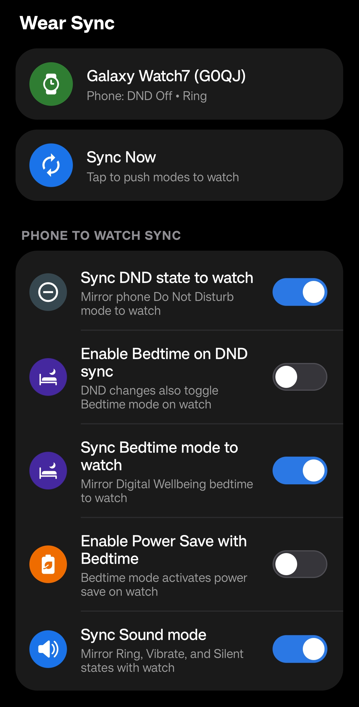
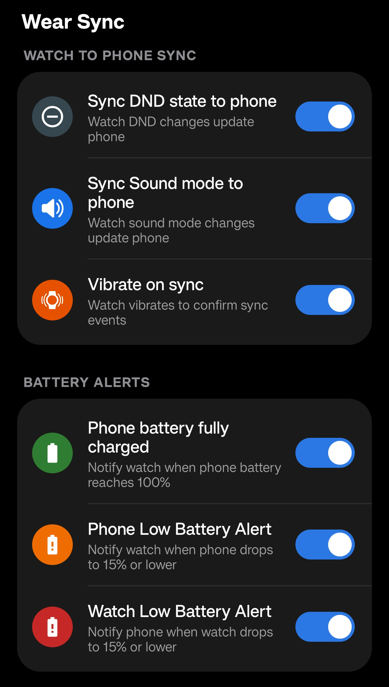
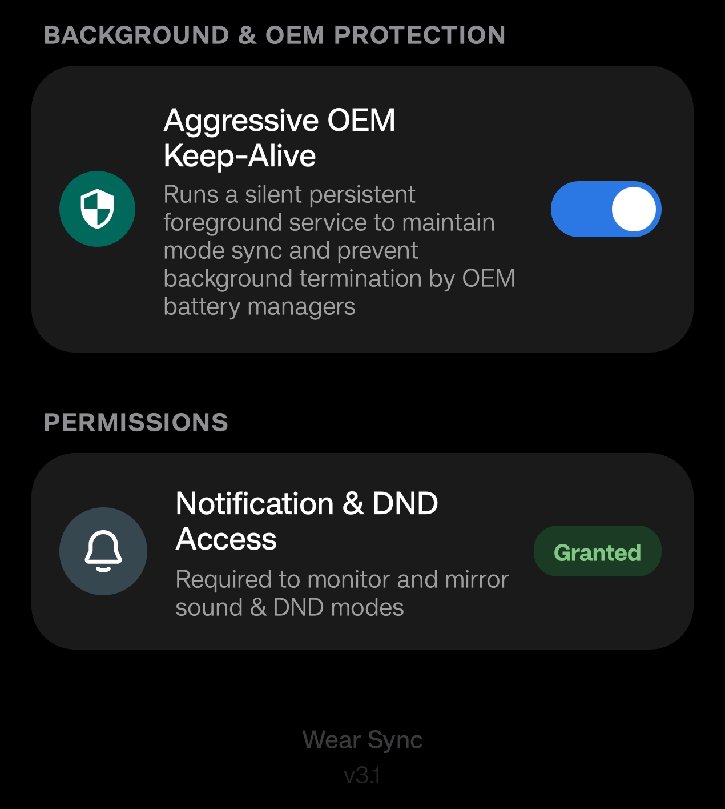
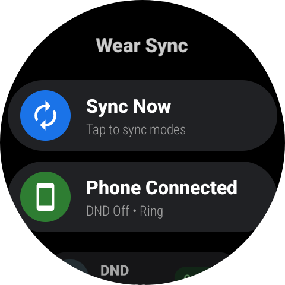
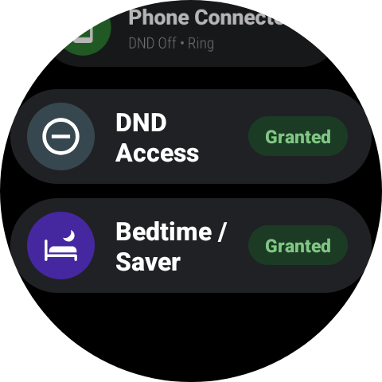

# Wear Sync (wear-mode-sync)

> **Upstream Attribution & Lineage**
>
> This project is an open-source continuation and extension of [Silleellie/dnd-bedtime-sync](https://github.com/Silleellie/dnd-bedtime-sync). Full credit and appreciation go to the original creators:
> - **[@rhaeus](https://github.com/rhaeus)** for the original DND-Sync architecture
> - **[@Silleellie](https://github.com/Silleellie)** for the DND-Bedtime-Sync app and ecosystem
> - **[@DreadedLama](https://github.com/DreadedLama)** for the initial Bedtime mode implementation

**wear-mode-sync (v3.1)** is re-architected for modern Android (API 36 / Android 14–16) and Wear OS 5/6, featuring a **Samsung One UI Watch** native interface, bidirectional sound & battery alerts, and an ultra-fast binary protocol.

---

## Screenshots

### Mobile App 
<p float="left">
  
  
  
</p>

### Wear OS App (Samsung One UI Watch)
<p float="left">
  
  
</p>

---

## Architecture & Service Topology

```mermaid
flowchart TD
    subgraph Upstream["Upstream Base Repos (rhaeus / Silleellie)"]
        U_DND["DND & Bedtime Only"] --> U_NLS["NotificationListenerService"]
        U_AOSP["Android System Server"] -- binds & wakes on event --> U_NLS
        U_WearMsg["Wearable MessageClient"]
        note1["No Foreground Service on Stock AOSP\n(Silently killed by OEM task killers)"]
    end

    subgraph CurrentApp["wear-mode-sync (v3.1)"]
        C_DND["DND & Bedtime"] --> C_NLS["NotificationListenerService"]
        C_Ringer["Alert Slider / Volume (Ringer Mode)"] --> C_Obs["In-Memory ContentObserver & BroadcastReceiver"]
        C_FGS["connectedDevice Foreground Service\n(Optional User Toggle)"]
        C_FGS -- Shields from OEM killers --> C_Obs
        C_FGS -- Shields from OEM killers --> C_NLS
        note2["Protects against OnePlus Athena / o-kill / MIUI / One UI\nGuarantees Alert Slider listener survival"]
    end

    style Upstream fill:#151b23,stroke:#30363d,stroke-width:1px
    style CurrentApp fill:#0d1117,stroke:#58a6ff,stroke-width:1px
```



### Can this app run without a Foreground Service?
**Yes.** Under **Settings $\rightarrow$ Background & OEM Protection**, you can toggle **"Aggressive OEM Keep-Alive"**:
- **Disabled**: Runs in pure background listener mode with zero persistent notifications (exact base repo behavior, ideal for stock Pixel/AOSP devices).
- **Enabled**: Runs a silent `connectedDevice` foreground service (`FGS/99/200`) to guarantee physical Alert Slider and volume mode survival against aggressive OEM task killers (OnePlus Athena / `o-kill`, Xiaomi MIUI/HyperOS, Samsung One UI sleep mode).

---

## Key Features

- **Samsung One UI Watch Interface**: Native circular list scaling designed for round watch displays.
- **Bidirectional Sound & Ringer Sync**: Synchronizes Ring, Vibrate, and Silent modes between phone and watch (supporting OnePlus Alert Slider and volume keys).
- **Bedtime & DND Synchronization**: Automatic two-way or one-way mirroring of Bedtime mode and Do Not Disturb.
- **Bidirectional Battery Alerts**: Notifications for phone full charge (100%) and low battery warnings (15%) across both devices.
- **Lightweight Binary Protocol**: Direct 6-byte `ByteBuffer` serialization over Bluetooth LE with zero debounce delays and minimal battery impact.
- **Aggressive OEM Protection**: Optional foreground service keep-alive to prevent OnePlus, Xiaomi, and Samsung background task killers from stopping sync.

---

## Device Compatibility

- **Smartwatches**: Tested on **Samsung Galaxy Watch 7 LTE (Wear OS 6 / One UI 8 Watch)**. Compatible with Galaxy Watch 9, 8, 7, 6, 5, 4 series, and Wear OS devices.
- **Smartphones**: Tested on **OnePlus Nord 5 (Android 16, OxygenOS)** with physical Alert Slider. Compatible with any non-Samsung Android smartphone (Android 10+) with Google Play Services.

---

## Setup Instructions

### Phone Setup
1. Download `dndsync-mobile.apk` from [Releases](https://github.com/iaryan08/wear-mode-sync/releases).
2. **Install**:
   - **Direct Install**: Open the downloaded APK file on your phone and tap **Install**.
   - **Via ADB** (if enrolled in *Google Advanced Protection* or direct sideloading is blocked):
     ```bash
     adb install -r dndsync-mobile.apk
     ```
3. Open the app and grant **Notification & DND Access** by tapping the permission banner.
   > *Note*: If Android grays out Notification Access, go to `Phone Settings -> Apps -> Wear Sync -> 3 dots (top right) -> Allow Restricted Settings`.

### Watch Setup
1. Connect your watch via **Wireless ADB**:
   - Enable Developer Options: `Settings -> About watch -> Software -> tap Software version 5 times`.
   - In *Developer Options*, enable `ADB debugging` and `Wireless debugging`.
   - Tap `Pair new device`, note the IP:Port and 6-digit Wi-Fi pairing code:
     ```bash
     adb pair <WATCH_IP>:<PAIRING_PORT> <PAIRING_CODE>
     adb connect <WATCH_IP>:<CONNECT_PORT>
     ```
2. Install `dndsync-wear.apk`:
   ```bash
   adb install -r dndsync-wear.apk
   ```
3. Grant required permissions:
   - **DND Access**:
     ```bash
     adb shell cmd notification allow_listener com.aryan.wearmodesync/com.aryan.wearmodesync.DNDNotificationService
     ```
   - **Bedtime & Power Saver Access**:
     ```bash
     adb shell pm grant com.aryan.wearmodesync android.permission.WRITE_SECURE_SETTINGS
     ```
4. Open the app on the watch and verify both permission cards display **Granted**.

> [!WARNING]
> **Turn off ADB & Wireless debugging** on your watch once setup is complete to preserve battery life!

---

## Preferences Guide

### Phone Preferences
- **Sync DND state**: 1-way or 2-way sync of Do Not Disturb mode.
- **Sync Sound/Vibrate/Silent mode**: Synchronizes sound profiles across hardware Alert Sliders, volume keys, and watch ringer modes.
- **Enable Bedtime mode on DND sync**: Automatically triggers Bedtime mode on the watch when DND is enabled on phones lacking the Digital Wellbeing app (e.g. Xiaomi).
- **Sync Bedtime mode to watch**: Directly mirrors Digital Wellbeing Bedtime mode from phone to watch.
- **Enable Power Saver with Bedtime**: Combines Bedtime mode with watch Power Saver mode.

### Battery Preferences
- **Phone battery fully charged**: Notifies watch when phone reaches 100%.
- **Phone Low Battery Alert**: Alerts watch when phone drops to 15%.
- **Watch Low Battery Alert**: Alerts phone when watch drops to 15%.

### Background & OEM Protection
- **Aggressive OEM Keep-Alive**: Toggle foreground service protection for OnePlus/Xiaomi/Samsung or pure background mode for Pixel/AOSP.

---

## Attribution & Lineage
This project is an open-source continuation and extension of [Silleellie/dnd-bedtime-sync](https://github.com/Silleellie/dnd-bedtime-sync) and [rhaeus/dnd-sync](https://github.com/rhaeus/dnd-sync). Full credit and attribution for original concepts and base architecture belong to [@rhaeus](https://github.com/rhaeus), [@Silleellie](https://github.com/Silleellie), and [@DreadedLama](https://github.com/DreadedLama).
